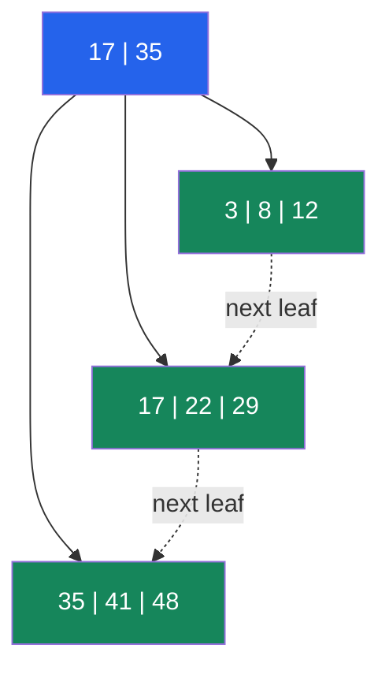
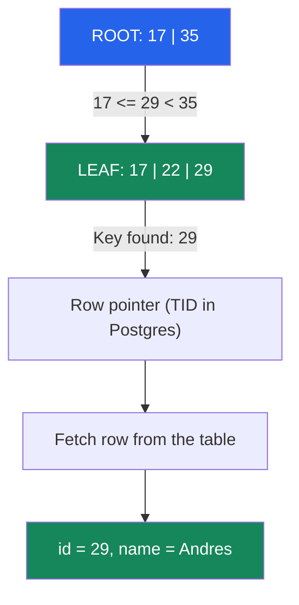
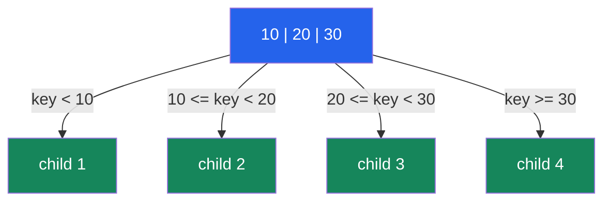

# Indexing

A database index is an additional data structure that let the database find rows without reading
the whole table, which speeds up reading operations.

The main tradeoffs are:
- Write operations (CREATE, DELETE and UPDATE) take more time because they have to update all the table's indexes of the changed column.
- The DB needs more storage to save this new data structures.

Most backend systems are read-heavy systems so indexing on specific columns used in
slow queries is usually worth it. For heavy write systems could be also worth it but measure first (e.g. with `EXPLAIN`) instead of indexing by assumption.

There are different index implementations, the most common ones are: hash index and B+Tree index.

## Hash Index

The hash index uses a hash function to compute the location of the value. They provide constant-time lookups so it doesn't matter if you have 10 or 1.000.000 rows, the lookup time is O(1) on average. It shines when the queries have equality comparisons, but cannot be used for range queries or partial matching.

## B+Tree Index

The B+Tree index creates a Balanced Tree where each node contains a sorted range of keys and the leafs contains the keys and the pointers to the rows.

When searching for `id = 29`:

Because leaves are sorted and linked, B-trees are excellent for range queries (`BETWEEN`, `>`, `<`), `ORDER BY` and prefix matching (`LIKE 'abc%'`): the DB finds the first matching leaf entry and walks the leaves from there.

### Degree

The "degree" of a B-tree controls how many keys and children a node can have.

An internal node with `k` keys has `k + 1` children, because the keys act as separators between child ranges. For example, a full node in a tree where each node has at most 4 children holds 3 keys:

In a database the degree is not set directly. It is determined by the **page size** (8 KB in Postgres, 16 KB in InnoDB) and the **key size**, since each node is one page. In practice a node holds hundreds of keys.

- Narrow keys (e.g. integers) → more keys per page → higher degree → shallower tree → fewer page reads per lookup.
- Wide keys (e.g. long strings, UUIDs stored as text) → fewer keys per page → lower degree → deeper tree and more pages → bigger index and more page reads per lookup.